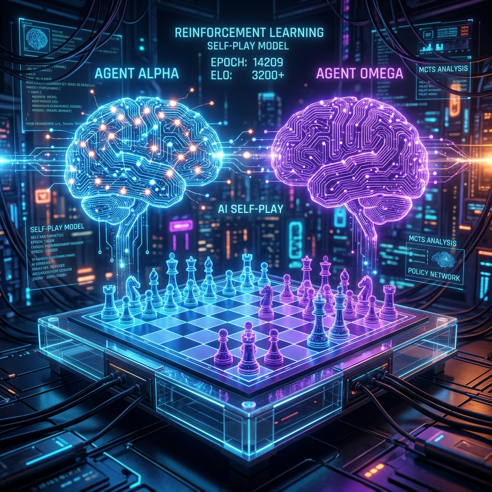

  
  
  # REINFORCEMENT LEARNING ACTIVITY 2
  
  **Name:** Jay Arre Talosig  
  **Code of Subject:** CCRNFLRL  
  **Section:** COM231ML  
  **Professor:** Florencio V. Contreras Jr.

 

---

### Part A – RL Problem Setup

**1. Choose a game or problem.**
**Game:** Chess

**2. Identify the Environment.**
**Environment:** The 8x8 chessboard containing 64 squares, the 32 pieces, and the current state/position of all the pieces on the board.

**3. Identify the Agent.**
**Agent:** The AI Chess Player, for example, the AI controlling the White pieces.

**4. Identify the Actions.**
**Actions:** Any legal move a piece can make on the board according to the rules of chess, such as moving a Pawn from e2 to e4, or moving a Knight from g1 to f3.

**5. Define the Reward Function.**
**Reward Function:** 
*   **Win (Checkmate):** +1
*   **Draw (Stalemate):** 0
*   **Lose (Checkmated):** -1
*   *(Optional intermediate rewards)*: +0.1 for capturing an opponent's piece, -0.1 for losing a piece.

 

---

### Part B – Exercise 1.1: Self-Play

**1. What do you think would happen when the agent plays against itself?**
Initially, the games would look completely random. However, as the agent plays thousands or millions of games against itself, both sides will continuously adapt. Whenever one version of the agent discovers a winning strategy, the other version will eventually learn how to defend against it, pushing both sides to become progressively stronger and smarter.

**2. Would the agent learn a different way of playing?**
Yes. If an agent plays against a fixed or random opponent, it only learns to exploit that specific opponent's weaknesses. By playing against itself, the agent learns a universally robust way of playing because its opponent is constantly adapting, evolving, and eliminating its own weaknesses. 

**3. How could self-play affect the agent's strategy?**
Self-play removes human bias from the agent's strategy. It forces the agent to develop highly balanced strategies that are strong both offensively and defensively. It might even discover unconventional, "alien-like" strategies that human players have never thought of, similar to what Google's AlphaZero did.

**4. What are the possible advantages of self-play?**
*   **No human data needed:** The agent can learn entirely from scratch without needing a database of human matches.
*   **Perfect scaling of difficulty:** The agent is always playing against an opponent of its exact skill level, which is the optimal condition for continuous improvement.
*   **Surpassing human limits:** Because it doesn't rely on human examples, it is not constrained by human mistakes or traditional ways of thinking.

**5. What problems or limitations might occur during self-play?**
*   **Overfitting to itself (Mode Collapse):** The agent might develop a very narrow set of strategies that only work well against its own playstyle, making it potentially vulnerable to completely different, random, or unpredictable strategies from a human player.
*   **High Computational Cost:** Self-play requires massive amounts of processing power and time, as the agent must simulate millions of games to learn effectively.
*   **Slow initial learning:** Because it starts with zero knowledge, the initial phase of learning is essentially random guessing, taking a very long time before any meaningful strategy emerges.
